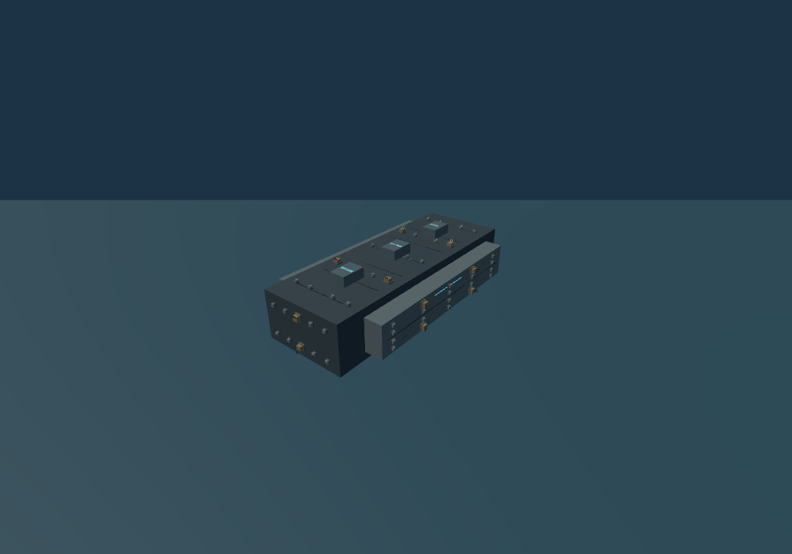
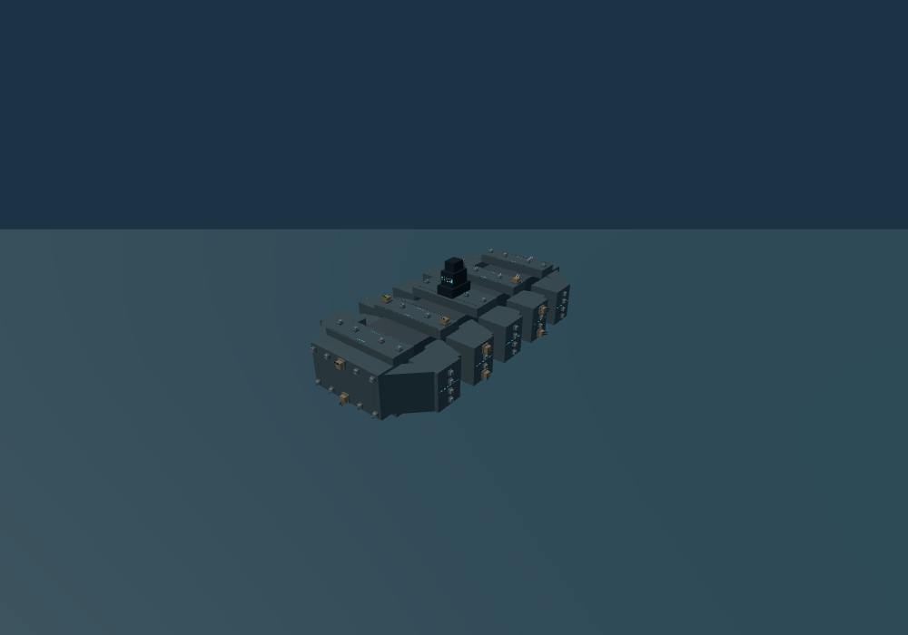
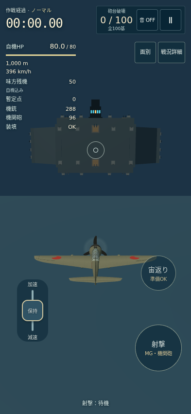

# ゲキチンの戦闘画面と巨大要塞の変更

対象: `chameleonjp-lab/gekichin`。開始点: `5608761348029bb65c635ffd7ab22014020afbec`。

2026-10-13の利用者依頼により、R10/R12/R65の形状と表示を変更する。基数、残機、操縦、採点、兵装、砲台HPは変更しない。他作品は参照のみとする。作業ブランチからDraft PRを作成し、マージ・公開は行わない。

## 実装前に決めた画面の構成

カイセンとファイトフライトの作戦時計、破壊数、左側の飛行情報、音・停止ボタン、中央照準の位置関係を参照する。戦況の一覧表を常時開く旧構成を変更する。

| 情報 | 初期の表示 | 操作・理由 |
| --- | --- | --- |
| 作戦時計・操作モード・砲台の破壊数/100 | 常時 | 時間と攻略の進み具合を上部で確認する |
| 自機HPとバー・高度・速度・味方残機・暫定スコア | 常時 | 左側で飛行と生存の状態を確認する |
| 機銃/機関砲の各残弾・装填状態 | 常時 | 兵器名を付け、射撃できるか判断できるようにする |
| 六面ごとの残存砲台 | 初期OFF | 「面別」をタップして表示/非表示を切り替える |
| 照準内の標的種類・面・損傷段階・HP・距離 | 初期閉 | 「戦況詳細」にまとめ、タップして確認する |
| 主砲/機銃の残数、現在出撃数、予備+復帰予約、命中率、命中内訳 | 初期閉 | 「戦況詳細」をタップして開閉する |
| 主砲危険・復帰/引継ぎ・境界警告 | 必要時に必ず表示 | 表示設定では隠さない |

面別の選択はページ内で再出撃時にも保持する。画面回転や幅の変化で詳細を勝手に開かない。詳細閲覧中は操縦・射撃の保持入力を解除して遮断する。戦闘と時計は継続し、そのことをパネル内に表示する。停止したい場合は共通の一時停止ボタンを使う。Escapeで詳細を閉じ、開閉ボタンへ焦点を戻す。

標的の数値は詳細を開いて読む方式のため、その間は同時に手動操縦できない。常時の画面では自機の状態と危険通知を優先し、標的の姿と損傷は従来の3D表示で確認する。小画面の文字拡大で標的欄と操作ボタンが重なることを避けるため、この構成を採用した。

幅320pxで文字を200%にした画面では、危険通知を左側の細い領域に配置する。通知が複数ある時は画面上部から表示し、左側の時計・飛行数値の一部より警告を優先する。面別・戦況詳細の入口と操縦ボタンには重ねない。主砲の回避、帰還方向、機体損失までの期限、復帰・引継ぎ・回廊待機の意味を保って文を短くし、幅や文字サイズを戻すと元の文を復元する。通常時は常時情報をすべて表示する。

## 実装前に決めた要塞の形

全長1,200m、全幅600m、主要船体厚240m、中心高度1,000mを基準とする。前後を絞った長大な装甲船体、左右の大型装甲ブロック、段差のある中央指令塔を組み合わせる。濃い船体と明るい装甲面を分け、青白い発光線・後部推進器の表示・下部の環状発光を補助として加える。古い直方体に表面模様だけを付ける方法ではなく、外形を変える。

実体のある船体と塔は共通の形状表から描画と接触判定を作る。見える空間を古い不可視の箱で塞がない。六面100基の砲台の位置と外向き接近経路を維持し、全100基の射線と機体の離隔を再確認する。発光や煙は接触しない装飾として区別する。

最終の形状表は次の構成とした。砲台と塔の底面は四隅まで船体が支えることを検査する。

| 部位 | 形と寸法 |
| --- | --- |
| 中央船体 | 幅240m・厚160m・長さ1,040mの細い骨格 |
| 前後の端面装甲 | 幅340m・厚180m・長さ80m。前後砲台を支える |
| 上下の砲座デッキ | 各5段、幅340m・厚40m。奥行は中央140m、その他100m |
| 左右の装甲 | 各5つの130×160×120mブロックと斜め連結部。前後は45度の装甲で絞る |
| 指令塔 | 幅80→64→48mに絞る3段。最高点は高度1,260m |

主要船体の最大範囲は幅600m・厚240m・全長1,200mを維持する。指令塔は旧上部構造の最高点1,170mから90m高く、主要船体の上端1,120mから140m高い。下面の環状光は新デッキ内に収まる大きさへ変更し、後部に4つの推進器表示を置く。

要件の対応: A02は寸法・100基と共通形状、A03は全100基の接近・射線・外周、A17は詳細開閉時の保持入力解除、A18は情報の分類と面別案内、A19は製品の3D描画画像、A20は縦横・文字200%・開閉と焦点の確認に対応する。A19の音の聴感、A20の実機読み上げ、A22の実機性能とA23の新外形での全作戦攻略は今回の自動検査の合格に含めない。

## 確認計画と実施結果

実装前の計画: 関係する単体検査、全単体検査、型と製品build、UI-only画面検査、追加した表示切替、320/393px縦画面・852×393横画面・文字200%を確認する。凍結した製品の3D描画で要塞の前後・上下・斜めを比較する。実装担当とは別のエージェントが最終差分を確認する。

最終ソースに対して次の検査が成功した。詳しい件数・テスト名・実行環境・ソースの対応は [verification.json](./evidence/hud-fortress-20261013/verification.json) に記録した。

| 確認 | 結果 |
| --- | --- |
| 全単体検査 | 145/145成功、失敗・skipなし。全100砲台の支持、接近経路、射線と外周を含む |
| 型検査と製品build | 成功 |
| UI-only画面検査 | 8/8成功、retryなし。320/393px縦・568/852px横、文字200%、長い点数・復帰待ち・面別ON、native Space開閉とEscape後の焦点を含む |
| 製品の通常入力 | 3/3成功、retryなし。Easyの時計と停止/再開、Normalの射撃と詳細閲覧中の入力遮断、閉じた後の操縦/射撃/一時停止、文字拡大時の速度レバー保存/preview一致 |
| 危険通知 | 320×568・文字200%の両modeで、主砲単独、境界/復帰との2件同時、復帰/引継ぎ/回廊待機を含む3件同時を確認。全通知が画面内に収まり、操縦と表示切替ボタンから8px以上離れる |
| 要塞の描画 | 製品FlightSceneの斜め・後方・下面画像を取得、38部品。凍結した形状確認用カメラであり、攻略/性能の証拠ではない |
| 保存した画面証拠 | 最終の製品7ファイルのSHA256と一致。dense画面はDOM表示のみ変更し、論理状態とtickが不変 |
| 独立レビュー | 別担当による差分・7ソース/11基準関数・画像と原票の照合。関連検査25/25成功、提出を妨げる指摘0 |

変更前後の形と通常画面:

[要塞の拡大画像](./evidence/hud-fortress-20261013/after-fortress-detail.png)も形状確認用のカメラで保存した。

独立レビューと最終提出commitのCI結果はPR本文/Checksにも結び付ける。実機iPhone/Safariの性能と人による操作感は未検証。過去の攻略証拠を新外形での全攻略証拠へ読み替えない。
